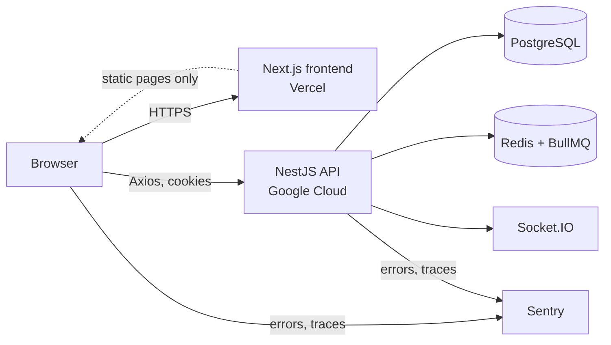

# Architecture — StartupsClub Web

> **Status: PROPOSED, to be approved by the owner.** AI agents must not change this structure.
> If something is missing here, ask. Do not invent it.

## 1. System context



- This repository is **only** the Next.js box. It never talks to the database.
- The frontend and API share a parent domain (for example `app.` and `api.`) so the httpOnly
  session cookie works for both.
- Real-time chat uses Socket.IO from the browser to the API (client wrapper in
  `features/messages`, added when chat is built; the owner must approve the library choice).

## 2. Route groups

```
src/app/
  (marketing)/   public pages, animated, SEO-indexable          -> docs/LANDING_PAGE.md
  (auth)/        login, signup, verify, reset, onboarding        -> docs/APP_FLOW.md
  (app)/         authenticated product, dashboard shell          -> docs/APP_FLOW.md
  layout.tsx     root: fonts, theme provider, query provider
  not-found.tsx, error.tsx, global-error.tsx
```

- Route groups do not change URLs. Each group has its own `layout.tsx`.
- `(marketing)` is the only place GSAP and Locomotive Scroll may be loaded.
- `(app)` uses the shadcn dashboard block as its shell and never loads marketing animation code.

## 3. Folder structure

```
src/
  app/                    routes only; pages are thin and compose feature components
  components/
    ui/                   shadcn generated primitives (do not hand-edit without approval)
    marketing/            components used only by (marketing)
    app/                  app shell pieces (sidebar, header, user menu)
    shared/               small components used by both areas (logo, theme toggle, empty state)
  features/
    <feature>/            one folder per product feature, named like the system design
      components/         feature-specific components
      hooks.ts            TanStack Query hooks (the only place that fetches or serves fixtures)
      api.ts              Axios calls (added when the backend is ready)
      fixtures.ts         hard-coded data, each marked "FIXTURE:"
      types.ts            TypeScript types for this feature
      schemas.ts          zod schemas for forms (if the feature has forms)
  lib/
    api-client.ts         the single Axios instance and interceptors
    query-client.ts       TanStack Query client and defaults
    utils.ts              cn() and tiny pure helpers
  providers/              QueryProvider, ThemeProvider, SmoothScrollProvider (marketing only)
  hooks/                  shared hooks (for example useMediaQuery)
  config/                 site.ts, navigation.ts, env.ts
  types/                  shared types (ApiEnvelope, ApiError, pagination)
  instrumentation.ts      Sentry server/edge registration and onRequestError (locations per Sentry docs)
  instrumentation-client.ts   Sentry browser initialisation
e2e/                      Playwright tests
docs/                     project documents
public/                   static assets
```

Feature folder names mirror the system design: `auth`, `onboarding`, `profile`, `standup`,
`ship-logs`, `clubs`, `seasons`, `progress`, `forum`, `rooms`, `network`, `events`,
`collaborators`, `messages`, `composer`, `tutors`, `notifications`, `billing`, `admin`,
`ai-coach`, `ai-matching`, `ai-assistant`.

## 4. Layering and import rules

```
app (routes)  ->  features  ->  components/ui, components/shared, lib, hooks, types
components/marketing  ->  components/ui, components/shared, lib
```

1. `app/` files contain layout and composition only, no data logic.
2. A feature may import from `components/ui`, `components/shared`, `lib`, `hooks`, `types`.
3. A feature **must not** import another feature's internals. If two features need the same
   thing, move it to `components/shared`, `hooks` or `types` (ask first).
4. `lib/` and `components/ui` never import from `features/`.
5. Only `features/*/hooks.ts` and `features/*/api.ts` may call `lib/api-client.ts`.
6. Components never import `fixtures.ts` directly. They use hooks.
7. Use the `@/` alias. No deep relative paths (`../../..`).

## 5. Data flow

```
Component -> feature hook (TanStack Query) -> queryFn
                                              |- today: returns FIXTURE data
                                              '- later: api.ts -> Axios -> NestJS /api/v1
```

Swapping from fixtures to the real API changes only `queryFn` inside the hook. Details and
conventions in `docs/STATE_AND_DATA.md`.

## 6. Cross-cutting concerns

| Concern          | Where                                                                                                              | Rule                                                                               |
| ---------------- | ------------------------------------------------------------------------------------------------------------------ | ---------------------------------------------------------------------------------- |
| Theme            | `providers/theme-provider.tsx` + shadcn toggle                                                                     | Class strategy; no flash on load; default is system (TO CONFIRM).                  |
| Server state     | `providers/query-provider.tsx`                                                                                     | One `QueryClient` per browser session.                                             |
| Auth guard       | `(app)/layout.tsx` and a session hook in `features/auth`                                                           | Redirect rules in `docs/APP_FLOW.md`.                                              |
| Errors           | `error.tsx` per route group, plus per-query error UI                                                               | Never a blank screen.                                                              |
| Smooth scroll    | `providers/smooth-scroll-provider.tsx`, used only in `(marketing)/layout.tsx`                                      | One instance; destroyed on unmount; disabled for reduced motion.                   |
| Animations       | `components/marketing/animations/`                                                                                 | GSAP inside `useGSAP` or effect with cleanup.                                      |
| Metadata and SEO | `config/site.ts`, `generateMetadata`                                                                               | Marketing pages only need full SEO.                                                |
| Monitoring       | `instrumentation.ts`, `instrumentation-client.ts`, `sentry.*.config.ts`, `global-error.tsx`, `error.tsx` per group | Sentry. Report unexpected errors only, no personal data. See `docs/MONITORING.md`. |

## 7. Decisions recorded

Choices and their reasons are in `docs/DECISIONS.md`. Add an entry for any architectural change
the owner approves.

## 8. Open points

- Whether the app uses any server components for data (currently no).
- Socket.IO client wrapper location and library (when chat starts).
- Whether `(auth)` stays a separate route group or merges into `(app)`.
- Whether Sentry setup uses the wizard or the manual files (`docs/MONITORING.md`).
